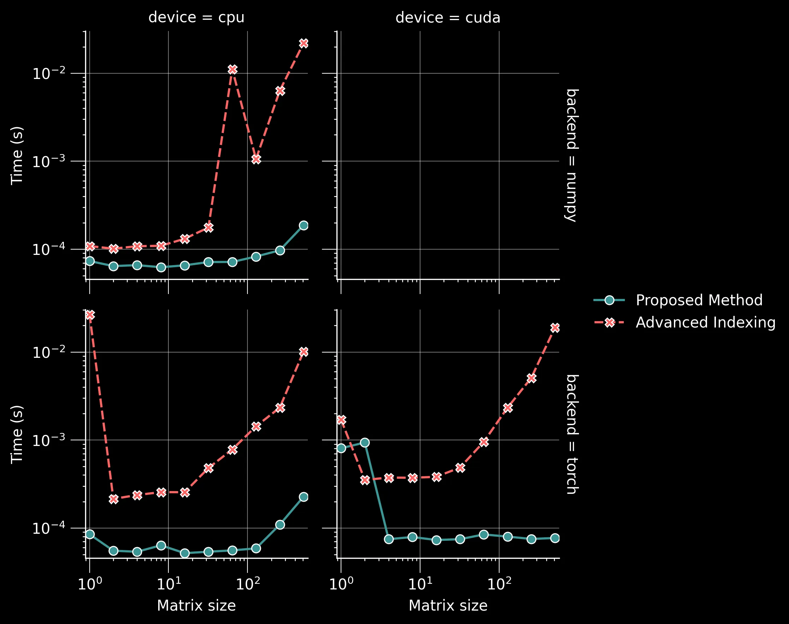
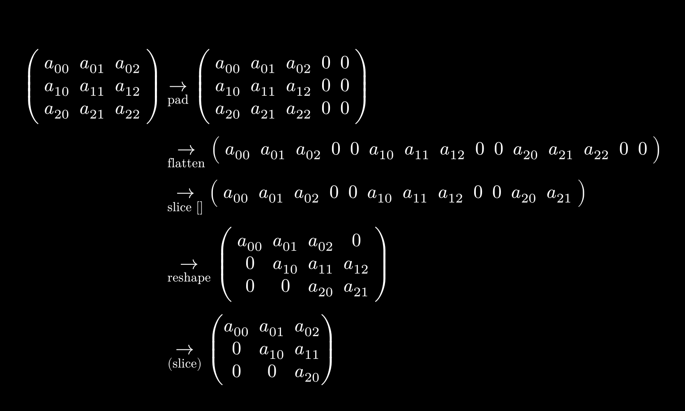

# Shift Nth Row N Steps

<p align="center">
  <a href="https://github.com/34j/shift-nth-row-n-steps/actions/workflows/ci.yml?query=branch%3Amain">
    
  </a>
  <a href="https://shift-nth-row-n-steps.readthedocs.io">
    
  </a>
</p>
<p align="center">
  <a href="https://codecov.io/gh/34j/shift-nth-row-n-steps">
    
  </a>
  <a href="https://github.com/astral-sh/uv">
    
  </a>
  <a href="https://github.com/astral-sh/ruff">
    
  </a>
  <a href="https://github.com/j178/prek">
    
  </a>
</p>
<p align="center">
  <a href="https://pypi.org/project/shift-nth-row-n-steps/">
    
  </a>
  
  
</p>

---

**Documentation**: <a href="https://shift-nth-row-n-steps.readthedocs.io" target="_blank">https://shift-nth-row-n-steps.readthedocs.io </a>

**Source Code**: <a href="https://github.com/34j/shift-nth-row-n-steps" target="_blank">https://github.com/34j/shift-nth-row-n-steps </a>

---

Shift Nth row N steps in NumPy / PyTorch / TensorFlow / JAX

## Installation

Install this via pip (or your favourite package manager):

```shell
pip install shift-nth-row-n-steps
```

## Usage

```python
from shift_nth_row_n_steps import shift_nth_row_n_steps

a = np.array([[1, 2, 3], [4, 5, 6], [7, 8, 9]])
shifted = shift_nth_row_n_steps(a)
print(shifted)
```

```text
[[1 2 3]
 [0 4 5]
 [0 0 7]]
```

`shift_nth_row_n_steps` is [array API](https://data-apis.org/array-api/latest/) compatible, which means it works with NumPy, PyTorch, JAX, and other libraries that implement the array API standard.

## Benchmark



## Algorithm


